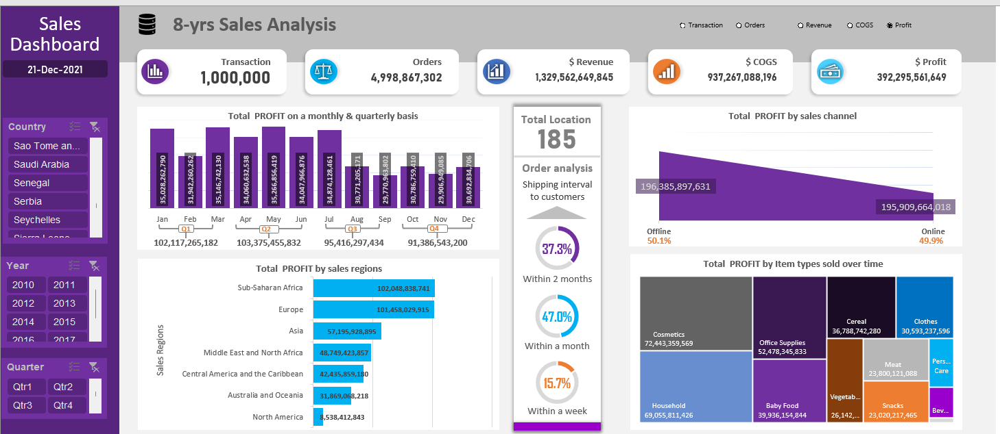

# 📊 8-Year Global Sales & Profitability Dashboard (Microsoft Excel)

## 📌 Project Overview
An advanced, interactive **Business Intelligence Dashboard** built entirely in **Microsoft Excel** to analyze **1,000,000 sales transactions** across **185 global locations** over an **8-year period (2010 – 2017)**. 

Because standard Excel worksheets struggle with 1M+ rows, this project leverages **Power Query**, **Power Pivot (Data Model)**, and **Dynamic Form Controls (Radio Buttons)** to allow users to seamlessly switch the entire dashboard's visual context between **Transactions, Orders, Revenue, COGS, and Profit**.

---

## 🖼️ Dashboard Preview

---

## 📂 Dataset & Project Files
* 📈 **Excel Dashboard File (`.xlsx`):** Contains the interactive dashboard, PivotTables, Slicers, and Form Controls.
* 🗄️ **Dataset Access (1,000,000 Rows):** [Download Raw Dataset / Excel Model from Google Drive](PASTE_YOUR_GOOGLE_DRIVE_LINK_HERE) *(Note: Add your Drive link here if the 1M-row file exceeds GitHub's 25MB upload limit, or remove this line if uploaded directly).*

---

## 🎯 Executive KPIs Summary
* **Total Transactions Analyzed:** `1,000,000 Transactions`
* **Total Units / Orders:** `4,998,867,302`
* **Total Revenue:** `$1,329,562,649,845` (~$1.33 Trillion)
* **Total Cost of Goods Sold (COGS):** `$937,267,088,196` (~$937.27 Billion)
* **Total Net Profit:** `$392,295,561,649` (~$392.30 Billion | **~29.5% Profit Margin**)
* **Global Reach:** `185 Countries / Locations`

---

## 🔍 Key Business Insights Uncovered

1. **Quarterly & Seasonal Profitability:**
   * **Q2 (`$103.38B`)** and **Q1 (`$102.12B`)** generate the highest profit performance, peaking in **May (`$35.27B`)**, **March (`$35.15B`)**, and **January (`$35.03B`)**.
   * Profitability experiences a slight dip during **Q3 (`$95.42B`)** and **Q4 (`$91.39B`)**, with the lowest monthly figure in **September (`$29.77B`)**.

2. **Regional Profit Distribution:**
   * **Sub-Saharan Africa (`$102.05B`)** and **Europe (`$101.46B`)** are the dominant profit-generating regions, together accounting for nearly **52% of global net profit**.
   * Followed by **Asia (`$57.20B`)**, **Middle East & North Africa - MENA (`$48.75B`)**, **Central America & the Caribbean (`$42.44B`)**, **Australia & Oceania (`$31.87B`)**, and **North America (`$8.54B`)**.

3. **Sales Channel Balance (Offline vs. Online):**
   * Net profit is almost evenly split between distribution channels: **Offline retail drives `50.1%` (`$196.39B`)** while **Online e-commerce drives `49.9%` (`$195.91B`)**, demonstrating a highly balanced omnichannel strategy.

4. **Product Category Profitability (Treemap Analysis):**
   * Top profit-contributing item types are **Cosmetics (`$72.44B`)**, **Household (`$69.06B`)**, **Office Supplies (`$52.48B`)**, **Baby Food (`$39.94B`)**, **Cereal (`$36.79B`)**, and **Clothes (`$30.59B`)**.

5. **Supply Chain & Shipping SLA Efficiency:**
   * Order fulfillment analysis shows that **`15.7%`** of orders are shipped **within a week**, **`47.0%`** **within a month**, and **`37.3%`** **within 2 months**, highlighting clear opportunities for logistics optimization.

---

## 🛠️ Excel Capabilities & Techniques Used
* **Big Data Handling in Excel:** Processed **1,000,000 records** using **Power Query** and **Excel Data Model (Power Pivot)** for high-speed aggregation.
* **Dynamic Metric Switching:** Implemented **Developer Form Controls (Radio/Option Buttons)** linked with lookup formulas (`INDEX/MATCH` & `CHOOSE`) so all charts dynamically update based on the selected KPI (`Transaction`, `Orders`, `Revenue`, `COGS`, or `Profit`).
* **Interactive Slicers:** Multi-select slicers on the left panel for **Country**, **Year (2010–2017)**, and **Quarter (Qtr1–Qtr4)**.
* **Advanced Charting:**
  * Custom Monthly Bar Chart with grouped Quarterly bracket totals (`Q1–Q4`).
  * Donut Gauge Charts for shipping interval breakdown.
  * Treemap for hierarchical product category comparison.
  * Slope/Area Chart for Offline vs. Online channel split.

---

## 📬 Contact & Connect
* **Author:** Mohamed Elkalaf
* **LinkedIn:** [in/mohamed-el-kallaf-305325326](https://www.linkedin.com/in/mohamed-el-kallaf-305325326)
* **Email:** mhmdelkalaf435@gmail.com
